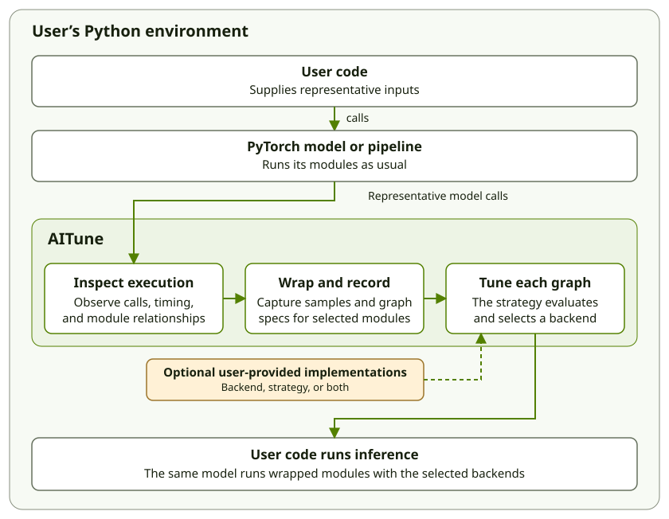

Before reading this guide, start with [Why AITune](../../learn/why_aitune.md) for the motivation and
[Core Concepts](../../learn/concepts.md) for the terms and workflows used here.

AITune runs alongside your model in your Python environment. Your code calls the model or pipeline with
representative inputs. AITune observes those calls and uses them to tune selected modules. During inference,
your code calls the same model or pipeline and the wrapped modules run their selected backends.

The diagram shows the explicit AOT workflow. You can use built-in backends and strategies or provide your
own implementations of either interface. See the [AOT and JIT comparison](../../learn/concepts.md#when-to-use-aot-or-jit)
for how each workflow starts and records calls.

## From an application call to an isolated module

1. **Inspect the application.** AOT inspection runs user-provided inputs to find executed modules and measure their
   calls. The optional call tree captures caller relationships, tensor sources, and observed external accesses to
   weights. For example, if Python code outside the selected module reads one of its weights, call tree information
   can help the wrapper preserve that weight during offload. JIT uses interception to discover eligible modules as
   the application runs.
2. **Record the boundary.** The wrapper runs the original forward and captures the samples and metadata needed to
   replay the flow independently. It groups observations by input specification and records input and output structures and
   supported changes to mutable inputs. See [Execution Graphs](execution_graphs.md) for graph matching,
   shape tracking, and [mutable inputs and caches](execution_graphs.md#mutable-inputs-and-caches).
3. **Evaluate implementations.** A strategy receives the original module, graph specification, and sample store.
   It decides which backend candidate to build, which checks and measurements to apply, and which implementation to
   return. A backend receives the same module-level context and owns compiler or runtime calls and resource
   management. Your code can provide a backend, a strategy, or both. See [Tuning Workflow](tuning_workflow.md)
   for how AITune builds, checks, profiles, and activates candidates.
4. **Run the selected backend.** The tuned wrapper uses incoming call metadata to dispatch to the selected backend
   for the matching graph. The surrounding pipeline still manages the inference request, including calls between
   modules. When AITune checks an incoming call against the tuned graph specifications, it raises an error if none match.

To reuse tuned results, load an AITune checkpoint into a compatible Python model or pipeline, or serve a supported
backend artifact directly. See [Deployment Overview](../deployment/deployment.md).

## Where to find the implementation

| Responsibility | Code |
| --- | --- |
| Explicit inspection, call tree, and wrapping | `aitune/torch/inspecting/` and `aitune/torch/call_tree/` |
| AOT tuning orchestration and JIT interception | `aitune/torch/tuning.py` and `aitune/torch/jit/` |
| Recording, graph specification, and runtime dispatch | `aitune/torch/module/recording_module.py`, `graph_spec.py`, and `tuned_module.py` |
| Strategy and backend interfaces | `aitune/torch/tune_strategy/tune_strategy.py` and `aitune/torch/backend/backend.py` |
| Validation, tuning measurements, and application profiling | `aitune/torch/task/` and `aitune/torch/performance/` |
| Persistence and serving integrations | `aitune/torch/checkpoint/`, `aitune/dynamo/`, and `aitune/triton/` |

For details on the call tree and weight relationships, see [AOT Inspection](../aot_inspect.md).
Tuning reports describe candidate evaluation and selection. Application profiling shows how each tuned or untuned
component contributes to request time. See [Observability](../../learn/observability.md),
[Extending AITune](extending_aitune.md), and [Design Decisions](design_decisions.md).
