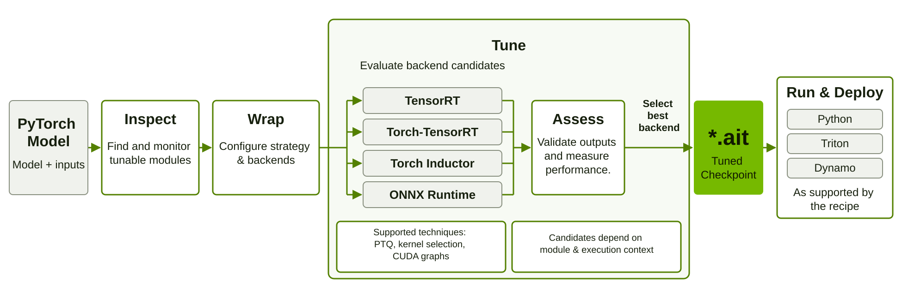

import { BadgeLinks } from "../_components/BadgeLinks";

<BadgeLinks
  badges={[
    {
      href: "https://github.com/ai-dynamo/aitune/blob/main/LICENSE",
      src: "https://img.shields.io/badge/License-Apache_2.0-blue",
      alt: "License",
    },
    {
      href: "https://www.python.org/downloads/",
      src: "https://img.shields.io/badge/python-3.11--3.14-blue",
      alt: "Python",
    },
    {
      href: "https://pytorch.org/",
      src: "https://img.shields.io/badge/PyTorch-2.8%2B-red",
      alt: "PyTorch",
    },
  ]}
/>

**NVIDIA AITune automates inference tuning for PyTorch models and pipelines on NVIDIA GPUs.**
It brings inference engines and acceleration techniques together under a single, extensible API. AITune combines
backend evaluation, correctness checks, and performance measurement into one workflow, selecting implementations
for individual modules according to the configured tuning strategy.

Start with a model from Hugging Face or timm, or bring your own model and checkpoint. For supported applications,
enable just-in-time tuning during inference, or use the explicit tuning API to prepare artifacts for deployment.

Find your model in the [recipe catalog](../../examples/README.md), or follow the [quick start](quick_start.md).

## Why AITune?

Modules in the same inference pipeline can differ in execution time, GPU memory use, input shapes, and how often
they run. The best backend and configuration can therefore vary by module. Inspection shows which modules run
and how they relate. AITune uses representative inputs to evaluate ways to speed up the modules you select.
Teams can extend AITune by implementing the backend and strategy interfaces in their own code.

Read [Why AITune](why_aitune.md) for the motivation, [Core Concepts](concepts.md) for the terms used throughout the
guides, and the [Architecture](../guides/advanced/architecture.md) for how the pieces fit together.

## How it works

AITune combines these stages into a workflow for each model or pipeline:

1. **Inspect.** Provide a PyTorch model and representative inputs. AITune finds tunable `nn.Module` components
   and observes their inputs and execution.
2. **Wrap.** Wrap the modules you want to tune so AITune can record their calls and later run them with the
   selected backend. You can choose a tuning strategy and backend candidates for each module.
3. **Tune.** Evaluate configured backend candidates, check inference behavior against recorded metadata,
   and measure performance on representative inputs. Select a backend using the configured strategy. Candidates can
   incorporate post-training quantization (PTQ), kernel selection, or CUDA graphs where supported by the backend.
4. **Run and deploy.** Run tuned modules in Python or save an AITune checkpoint (`.ait`) to load in a compatible
   application. Supported backends can also export a deployment artifact, such as a TensorRT engine. See
   [Deployment Overview](../guides/deployment/deployment.md).

## Getting started

Follow the [installation guide](install.md) to set up your environment. Use the
[AOT and JIT comparison table](concepts.md#when-to-use-aot-or-jit) to choose a workflow, then follow the
[Quick Start](quick_start.md) to tune a Stable Diffusion pipeline.

## Model recipes

Explore [ready-to-use model recipes](../../examples/README.md) for tuning, validation, benchmarking, and deployment.
Choose a model and a configuration for your GPU setup, precision, and deployment target, then adapt the recipe
with your own compatible checkpoint and data.
